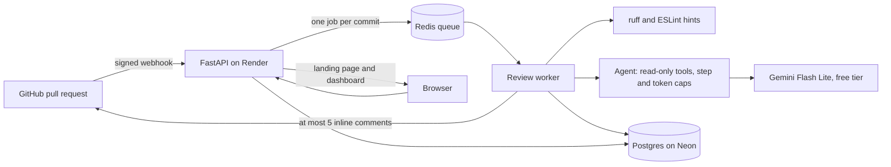

# DiffMate

An AI reviewer for GitHub pull requests. It reads each change and leaves at most five inline comments, only where it finds a likely bug or security problem. It never changes your code, and it runs entirely on free tiers: $0.

**Live:** [diffmate-kgzb.onrender.com](https://diffmate-kgzb.onrender.com) · **[Install the GitHub App](https://github.com/apps/diffmate-vighnesh/installations/new)** (public repositories only) · [](https://github.com/5-Vighnesh-0/diffmate/actions/workflows/ci.yml)

## Results at a glance

Measured on 60 pull requests from 10 open-source projects, each with a known answer. 12 were held back and run once, after all tuning.

| | Held-out set (12 PRs) | Tuning set (48 PRs) |
| --- | --- | --- |
| Comments that were right (precision) | **100%** | 100% |
| Bugs found (recall) | **30%** | 55% |
| False alarms per pull request | **0.00** | 0.00 |
| Cost per review | $0 (≈ $0.003 at paid prices) | $0 (≈ $0.004) |

When DiffMate comments, it has been right every time so far. It also misses most bugs, and says so. Full tables below and in [docs/benchmark.md](docs/benchmark.md).

## How it works



1. A GitHub App sends a webhook when a pull request is opened or updated. The API checks its signature, ignores replays, and queues one job per commit.
2. The worker downloads that commit and gives the AI four read-only tools: read a file, search the repository, view part of the diff, and find related tests. Hard caps: 8 steps, 60k tokens, and a daily request limit.
3. Findings are filtered (only on changed lines, confidence 70% or more, or 90% for kinds of notes the repo's votes marked mostly not useful; no duplicates; at most 5) and posted as one review. When DiffMate is 95% sure and knows the fix, the comment includes a GitHub suggestion the author can commit in one click; DiffMate itself never changes code.
4. The dashboard shows every review in plain language, each note with Useful / Not useful buttons, and the AI's steps. Your votes become your own accuracy score.

## What is in it

- **The reviewer:** an agent loop on the Gemini Interactions API with function calling, stateless requests, and a forced final submit.
- **Security:** HMAC webhook checks with replay protection, GitHub App tokens scoped to one repository, read-only tools confined to the checkout, untrusted PR text wrapped and defused against prompt injection (8 of 8 planted attacks resisted), GitHub login with PKCE and CSRF tokens, per-user authorization, rate limits, strict CSP. Every control names its test in [docs/threat-model.md](docs/threat-model.md).
- **The benchmark:** 60 offline cases (35 planted bugs, 15 real bug fixes undone, 10 bug-free changes), a resumable runner, and a scorer that compares three setups. `make bench`.
- **The frontend:** a scroll-driven landing page where your scroll moves a real recorded pull request through DiffMate, event by event with timestamps, until the comment lands on the bug; and a dashboard written for people new to code review.
- **Tests:** 197 backend tests (unit, security, integration on real Postgres and Redis) and frontend tests, run in CI with pip-audit, pnpm audit, and gitleaks on the full history.

## Benchmark

Three setups on the same cases: linters alone, the AI alone, and the AI with DiffMate's filters. Method, matching rule, and every run in [docs/benchmark.md](docs/benchmark.md).

Held-out set, run once:

<!-- bench:holdout -->
| Setup | Precision | Recall | FP / PR | Est. cost / PR | p50 | p95 |
| --- | --- | --- | --- | --- | --- | --- |
| 1. Linter only | 67% | 20% | 0.08 | $0.0000 | 0.1 s | 1.4 s |
| 2. Agent only | 100% | 30% | 0.00 | $0.0030 | 29.9 s | 40.0 s |
| 3. Agent + filtering | 100% | 30% | 0.00 | $0.0030 | 29.9 s | 40.0 s |

12 cases (holdout), `gemini-3.5-flash-lite`, case set `2fe57354e31e`, 65 requests. Cost is estimated at list price; the free tier costs $0.
<!-- /bench:holdout -->

The linters' 20% on the held-out set is really 10%: one of their two hits was an unrelated warning that happened to land within 3 lines of a bug.

Tuning set:

<!-- bench:dev -->
| Setup | Precision | Recall | FP / PR | Est. cost / PR | p50 | p95 |
| --- | --- | --- | --- | --- | --- | --- |
| 1. Linter only | 17% | 2% | 0.10 | $0.0000 | 0.2 s | 2.4 s |
| 2. Agent only | 100% | 55% | 0.00 | $0.0037 | 38.6 s | 140.8 s |
| 3. Agent + filtering | 100% | 55% | 0.00 | $0.0037 | 38.6 s | 140.8 s |

48 cases (dev), `gemini-3.5-flash-lite`, case set `2fe57354e31e`, 307 requests. Cost is estimated at list price; the free tier costs $0.
<!-- /bench:dev -->

What the numbers taught: the first run found 27% of bugs because the AI sometimes used all its steps without answering. Forcing a final submit doubled recall to 55%. Setups 2 and 3 match because the model posts few, confident findings, so the filter had nothing to remove.

## Limits, honestly

- It misses most bugs. Divide-by-zero mistakes are a consistent blind spot for the free model.
- It runs on Gemini's free tier, where Google may use what it receives to improve its products, so it reviews public repositories only. Pull requests in private repositories are ignored.
- One free daily AI limit (about 50 to 80 reviews a day) is shared by everyone using this deployment.
- The free server may restart at any time; people sign in again, and reviews and votes are kept.

## Run it yourself

Prerequisites: Docker, Python 3.12 with [uv](https://docs.astral.sh/uv/), Node.js 22 with pnpm.

```bash
cp .env.example .env    # fill in your own values; see docs/runbooks/github-app-setup.md
docker compose up       # Postgres, Redis, API, worker, frontend on 127.0.0.1
```

```bash
make test        # backend and frontend tests
make lint        # ruff and the frontend type check
make bench       # benchmark, tuning set (needs a free Gemini API key in .env)
make injection   # live prompt-injection suite
```

Hosting for $0 with no card (Render, Neon, UptimeRobot): [docs/runbooks/deploy.md](docs/runbooks/deploy.md).

## Tech stack

Python 3.12, FastAPI, SQLAlchemy 2 with Alembic, arq on Redis, Postgres, Gemini (`google-genai`), TypeScript, React 19, Vite, Motion, Vitest, Docker, GitHub Actions. Hosted on Render (free) with Neon Postgres (free).

## Documentation

| Doc | What it covers |
| --- | --- |
| [docs/PRD.md](docs/PRD.md) | Product requirements |
| [docs/PLAN.md](docs/PLAN.md) | Phased build plan and decisions |
| [docs/architecture.md](docs/architecture.md) | Components, data flow, data model |
| [docs/api.md](docs/api.md) | HTTP API |
| [docs/threat-model.md](docs/threat-model.md) | Threats, controls, and the test for each |
| [docs/benchmark.md](docs/benchmark.md) | Evaluation method and every run |
| [docs/testing.md](docs/testing.md) | Test strategy and CI gates |
| [docs/adr/](docs/adr/) | Architecture decisions |
| [docs/runbooks/](docs/runbooks/) | GitHub App setup, deploy, secrets, incidents |
| [docs/DESIGN.md](docs/DESIGN.md) | Design tokens and motion |
| [scrollcraft/builds/diffmate-landing/BRIEF.md](scrollcraft/builds/diffmate-landing/BRIEF.md) | Landing page brief |
| [reports/](reports/) | Phase reports and day-by-day logs |
| [SECURITY.md](SECURITY.md) | Reporting vulnerabilities |
| [CONTRIBUTING.md](CONTRIBUTING.md) | How to contribute |

## License

[MIT](LICENSE). The benchmark cases contain excerpts of other open-source projects, which stay under their own licenses: [benchmark/cases/THIRD_PARTY.md](benchmark/cases/THIRD_PARTY.md).
