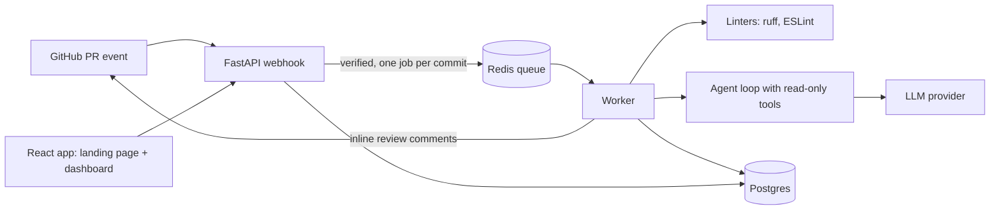

# DiffMate

An AI agent that reviews GitHub pull requests and leaves inline comments on likely bugs, security issues, and missing tests. It reads and comments only. It never changes your code.

> **Status:** planning. DiffMate is a working name. Every number in this README stays blank until the benchmark has actually run.

## Why

Small teams, student teams, and solo developers often merge with no second reviewer. DiffMate gives them a first pass within minutes of opening a PR.

## How it works



1. A GitHub App sends a webhook when a PR is opened or updated.
2. The API verifies the signature and queues one job per commit.
3. The worker runs linters, then an agent that can read files, search the repo, view diff hunks, and list related tests, under hard step and token caps.
4. Findings are filtered (dedupe, confidence threshold, at most 5 per PR) and posted as inline review comments.
5. The dashboard shows every run, its step-by-step trace, and each finding with accept and reject buttons.

## Features (v1)

- Automatic PR review for Python and TypeScript
- Structured findings: file, line, category, severity, confidence, explanation
- Guardrails: signature checks, read-only tools, prompt-injection defenses, cost caps
- Dashboard with agent traces and feedback buttons
- Reproducible benchmark comparing three setups
- Landing page with scroll-driven motion

Out of scope for v1: auto-fixing code, multi-org management, fine-tuning, other languages.

## Quickstart

Available after Phase 1 of the plan.

Prerequisites: Docker, Node.js, Python 3.12.

```bash
cp .env.example .env     # fill in real values yourself; see docs/runbooks/github-app-setup.md
docker compose up        # postgres, redis, backend, worker, frontend
```

Common commands:

```bash
make dev     # run everything locally
make test    # backend and frontend tests
make lint    # ruff, ESLint, type checks
make bench   # run the benchmark
```

## Benchmark results

Filled in by `make bench-score` from a committed results file. Method: [docs/benchmark.md](docs/benchmark.md).

<!-- bench:dev -->
| Setup | Precision | Recall | FP / PR | Est. cost / PR | p50 | p95 |
| --- | --- | --- | --- | --- | --- | --- |
| 1. Linter only | 17% | 2% | 0.10 | $0.0000 | 0.0 s | 1.1 s |
| 2. Agent only | 100% | 27% | 0.00 | $0.0039 | 35.2 s | 40.3 s |
| 3. Agent + filtering | 100% | 27% | 0.00 | $0.0039 | 35.2 s | 40.3 s |

48 cases (dev), `gemini-3.5-flash-lite`, case set `2fe57354e31e`, 316 requests. Cost is estimated at list price; the free tier costs $0.
<!-- /bench:dev -->

| Setup | Precision | Recall | False positives per PR | Cost per PR | Latency p50 / p95 |
| --- | --- | --- | --- | --- | --- |
| Linter only | not run | not run | not run | not run | not run |
| Agent only | not run | not run | not run | not run | not run |
| Agent plus filtering | not run | not run | not run | not run | not run |

## Tech stack

Python 3.12, FastAPI, Redis, Postgres, SQLAlchemy and Alembic, TypeScript, React (Vite), Framer Motion, Docker, GitHub Actions. The LLM provider and hosting are not chosen yet.

## Documentation

| Doc | What it covers |
| --- | --- |
| [docs/PRD.md](docs/PRD.md) | Product requirements |
| [docs/PLAN.md](docs/PLAN.md) | Phased build plan |
| [docs/architecture.md](docs/architecture.md) | Components, data flow, data model |
| [docs/api.md](docs/api.md) | HTTP API |
| [docs/threat-model.md](docs/threat-model.md) | Threats and mitigations |
| [docs/benchmark.md](docs/benchmark.md) | Evaluation method |
| [docs/testing.md](docs/testing.md) | Test strategy and CI gates |
| [docs/adr/](docs/adr/) | Architecture decisions |
| [docs/runbooks/](docs/runbooks/) | Setup, deploy, secrets, incidents |
| [docs/DESIGN.md](docs/DESIGN.md) | Design tokens and scroll transitions |
| [docs/RULES.md](docs/RULES.md) | One-page rulebook (wins on conflict) |
| [docs/BUILD_PROMPT.md](docs/BUILD_PROMPT.md) | Original build brief |
| [reports/](reports/) | Phase reports and weekly day-by-day logs |
| [SECURITY.md](SECURITY.md) | Reporting vulnerabilities |
| [CONTRIBUTING.md](CONTRIBUTING.md) | How to contribute |

## License

Not chosen yet.
