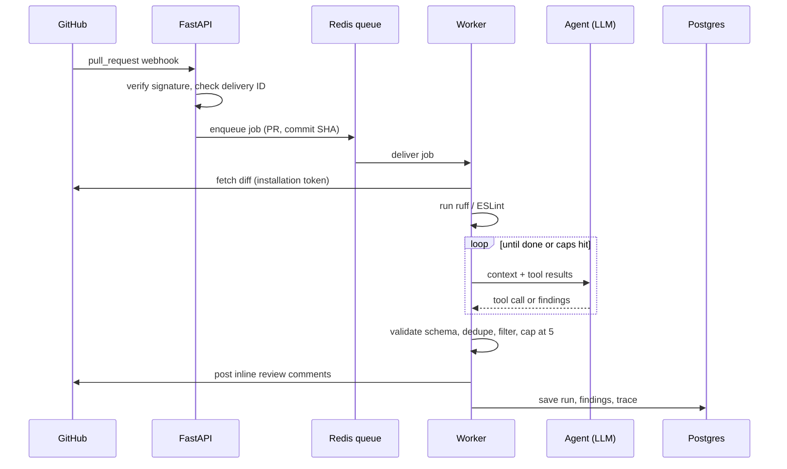

# Architecture

Status: Phase 1 built; data model approved 2026-10-07.

## Components

| Component | Responsibility |
| --- | --- |
| GitHub App | Sends PR webhooks; grants short-lived installation tokens |
| FastAPI service | Verifies webhooks, queues jobs, serves the dashboard API |
| Redis queue | Holds one job per commit; supports retries |
| Worker | Runs linters, the agent loop, filtering, and comment posting |
| Agent | LLM with four read-only tools under step and token caps |
| Postgres | Stores installations, runs, findings, traces, feedback |
| React app | Landing page and dashboard |
| Caddy | TLS termination and reverse proxy in deployment |

## Data flow



## Agent loop

- Input: diff, linter output, and a system prompt that labels all PR content as untrusted data.
- Tools (read-only): `read_file`, `search_repo`, `view_diff_hunk`, `list_related_tests`.
- Limits: maximum steps and maximum tokens per run, both configurable. When a cap is hit, the loop stops and returns what it has.
- Output: findings validated against a strict schema. Anything that fails validation is dropped, never posted.
- No shell, no network, no file writes.

## Filtering

1. Drop findings below the confidence threshold.
2. Drop duplicates (same file, nearby line, same category).
3. Sort by severity then confidence, keep at most the comment cap (5 by default).

## Data model (approved 2026-10-07; first migration in Phase 2)

Rules followed: `bigint` identity keys, `text` + check constraints instead of enums, `timestamptz`, every foreign key indexed (directly or as the first column of a unique index), cursor pagination. No users table: GitHub is the identity provider, sessions live in Redis, and the user's installation IDs come from GitHub at login. Webhook delivery IDs also stay in Redis (7-day TTL), not in Postgres.

| Table | Purpose | Key constraints |
| --- | --- | --- |
| installations | One row per GitHub App installation | unique `github_installation_id` |
| repos | Repos the App can see | unique `github_repo_id`; FK → installations |
| pull_requests | PRs that were reviewed | unique `(repo_id, number)` |
| runs | One review per PR commit | unique `(pull_request_id, commit_sha)` |
| findings | Everything the linters/agent found, posted or dropped | FK → runs; checks on category, severity, confidence, status |
| trace_steps | One row per agent step, metadata only | unique `(run_id, step_no)` |
| feedback | Accept/reject per user per finding | unique `(finding_id, github_user_id)` |
| benchmark_cases | Frozen benchmark set | unique `name`; split dev/holdout |
| benchmark_runs | One result per case × setup × batch | unique `(batch, case_id, setup)` |

```sql
create table installations (
  id bigint generated always as identity primary key,
  github_installation_id bigint not null unique,
  account_login text not null,
  created_at timestamptz not null default now()
);

create table repos (
  id bigint generated always as identity primary key,
  installation_id bigint not null references installations(id) on delete cascade,
  github_repo_id bigint not null unique,
  full_name text not null,
  created_at timestamptz not null default now()
);
create index repos_installation_id_idx on repos (installation_id);

create table pull_requests (
  id bigint generated always as identity primary key,
  repo_id bigint not null references repos(id) on delete cascade,
  number integer not null check (number > 0),
  title text not null check (length(title) <= 300),  -- untrusted; shown as plain text only
  unique (repo_id, number)
);

create table runs (
  id bigint generated always as identity primary key,
  pull_request_id bigint not null references pull_requests(id) on delete cascade,
  commit_sha text not null check (commit_sha ~ '^[0-9a-f]{40}$'),
  status text not null default 'queued'
    check (status in ('queued', 'running', 'done', 'failed', 'paused_daily_cap')),
  llm_requests integer not null default 0,
  tokens_in integer not null default 0,
  tokens_out integer not null default 0,
  est_cost_usd numeric(10, 6) not null default 0,  -- estimate at list price; actual spend is $0
  error text check (length(error) <= 500),         -- short reason, never secrets or diffs
  created_at timestamptz not null default now(),
  started_at timestamptz,
  finished_at timestamptz,
  unique (pull_request_id, commit_sha)
);

create table findings (
  id bigint generated always as identity primary key,
  run_id bigint not null references runs(id) on delete cascade,
  source text not null check (source in ('linter', 'agent')),
  file text not null check (length(file) <= 500),
  line integer not null check (line > 0),
  category text not null check (category in ('bug', 'security', 'missing_test')),
  severity text not null check (severity in ('low', 'medium', 'high')),
  confidence numeric(3, 2) not null check (confidence between 0 and 1),
  explanation text not null check (length(explanation) <= 2000),
  status text not null
    check (status in ('posted', 'dropped_low_confidence', 'dropped_duplicate', 'dropped_over_cap',
                      'dropped_not_in_diff', 'dropped_stricter')),  -- added by migrations 0002 and 0003
  github_comment_id bigint
);
create index findings_run_id_idx on findings (run_id);

create table trace_steps (
  id bigint generated always as identity primary key,
  run_id bigint not null references runs(id) on delete cascade,
  step_no integer not null check (step_no > 0),
  tool text not null,
  summary text not null check (length(summary) <= 500),  -- e.g. "read_file app/x.py lines 10-40"; no contents
  tokens_in integer not null default 0,
  tokens_out integer not null default 0,
  duration_ms integer not null default 0,
  unique (run_id, step_no)
);

create table feedback (
  id bigint generated always as identity primary key,
  finding_id bigint not null references findings(id) on delete cascade,
  github_user_id bigint not null,
  verdict text not null check (verdict in ('accept', 'reject')),
  created_at timestamptz not null default now(),
  unique (finding_id, github_user_id)
);

create table benchmark_cases (
  id bigint generated always as identity primary key,
  name text not null unique,
  kind text not null check (kind in ('real', 'seeded')),
  split text not null check (split in ('dev', 'holdout')),
  source_repo text not null,
  source_url text,
  license text not null,
  labels jsonb not null,           -- expected findings: file, line, category
  frozen_at timestamptz
);

create table benchmark_runs (
  id bigint generated always as identity primary key,
  batch text not null,             -- e.g. "2026-10-30-ab12cd3" (date + git sha)
  case_id bigint not null references benchmark_cases(id) on delete cascade,
  setup text not null check (setup in ('linter_only', 'agent_only', 'agent_filtered')),
  model text,
  metrics jsonb not null,          -- tp, fp, fn, latency_ms, tokens_in, tokens_out, est_cost_usd
  created_at timestamptz not null default now(),
  unique (batch, case_id, setup)
);
create index benchmark_runs_case_id_idx on benchmark_runs (case_id);
```

### Main queries (all parameterized through SQLAlchemy)

```sql
-- Dashboard run list: only the user's installations, newest first, keyset pagination
select r.id, re.full_name, p.number, r.commit_sha, r.status, r.est_cost_usd, r.created_at,
       (select count(*) from findings f where f.run_id = r.id and f.status = 'posted') as findings
from runs r
join pull_requests p on p.id = r.pull_request_id
join repos re on re.id = p.repo_id
join installations i on i.id = re.installation_id
where i.github_installation_id = any(:installation_ids)
  and (:cursor::bigint is null or r.id < :cursor)
order by r.id desc
limit :limit;

-- Feedback: one vote per user per finding; the API checks the finding belongs to the user's installations first
insert into feedback (finding_id, github_user_id, verdict)
values (:finding_id, :github_user_id, :verdict)
on conflict (finding_id, github_user_id)
do update set verdict = excluded.verdict, created_at = now();

-- Benchmark summary for the latest batch
select setup,
       sum((metrics->>'tp')::int) as tp, sum((metrics->>'fp')::int) as fp, sum((metrics->>'fn')::int) as fn,
       percentile_cont(0.5)  within group (order by (metrics->>'latency_ms')::int) as p50_ms,
       percentile_cont(0.95) within group (order by (metrics->>'latency_ms')::int) as p95_ms,
       avg((metrics->>'est_cost_usd')::numeric) as est_cost_per_pr
from benchmark_runs
where batch = (select batch from benchmark_runs order by created_at desc limit 1)
group by setup;
```

### Retention

- Stored: IDs, PR number and title, finding text, trace *metadata*. Never stored: file contents, diffs, tokens, secrets.
- `runs` older than 90 days are deleted by a daily worker job (cascades to findings, trace steps, feedback). Benchmark tables are kept: they are the results.
- Scale is tiny (a demo plus about 100 benchmark PRs), so there is no partitioning; the indexes above cover every query.

## Idempotency and reliability

- One run per (pull request, commit SHA). A duplicate job is a no-op.
- Webhook delivery IDs are remembered to ignore replays.
- Jobs retry with backoff. After the final retry the run is marked failed and shown in the dashboard.
- Comment posting is skipped if the same finding was already posted for that commit.

## Failure modes

| Failure | Behavior |
| --- | --- |
| LLM provider error or timeout | Retry; then mark run failed, post nothing |
| GitHub API rate limit | Back off and retry |
| Cap reached mid-run | Stop loop, filter what exists, post what passes |
| Invalid agent output | Drop it, log the validation error |
| Daily spend limit reached | Pause new runs, show a notice in the dashboard |

## Observability

Structured JSON logs with run ID, no secrets, no diffs. Every run's trace is stored and visible in the dashboard. Health endpoint for the API, worker heartbeat in Redis.

## Deployment topology

Caddy in front of the FastAPI service and the static frontend. Worker, Redis, and Postgres on a private network. Only the proxy is exposed. The worker's outbound traffic goes only to the GitHub API and the LLM provider.
